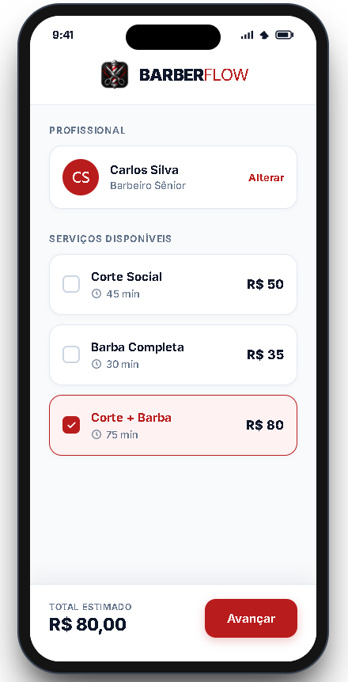
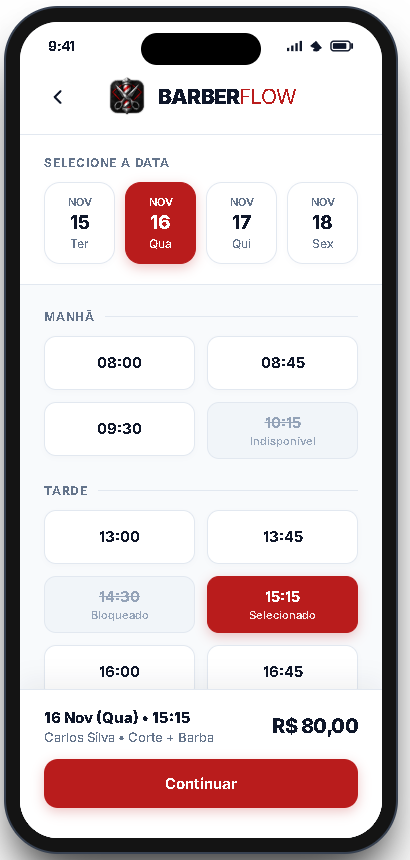
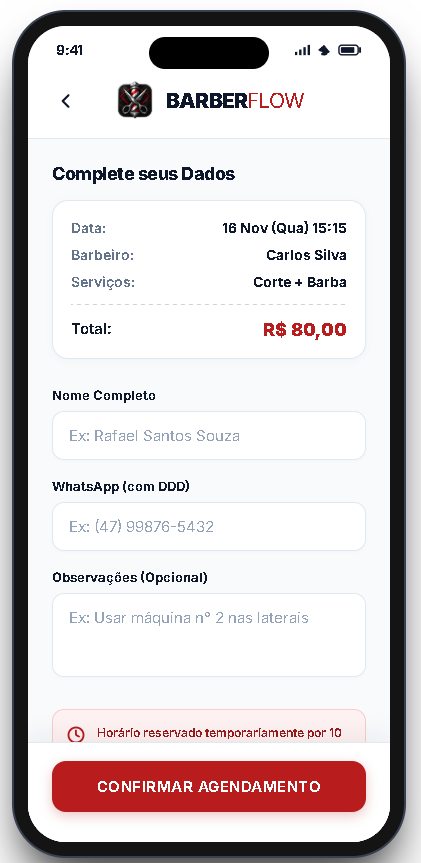
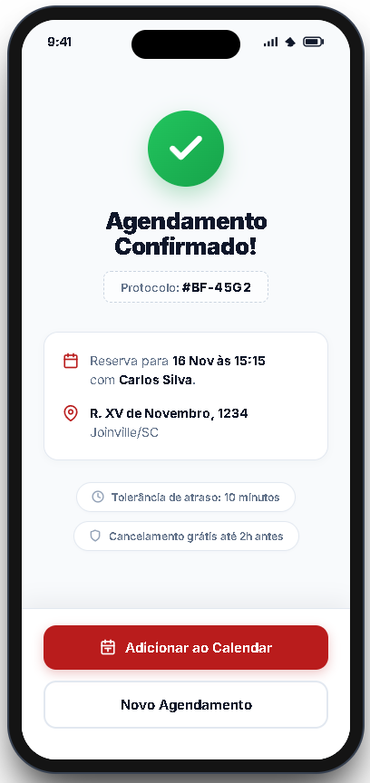
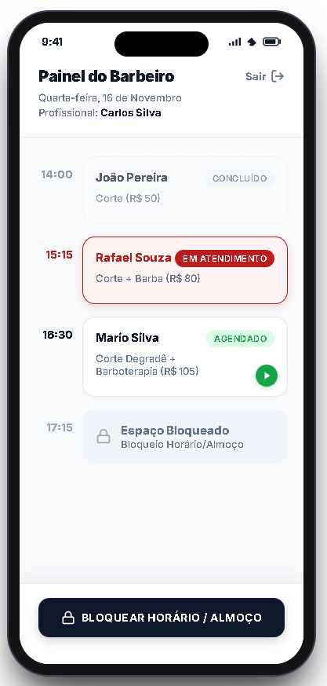
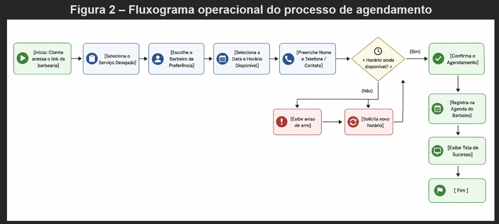
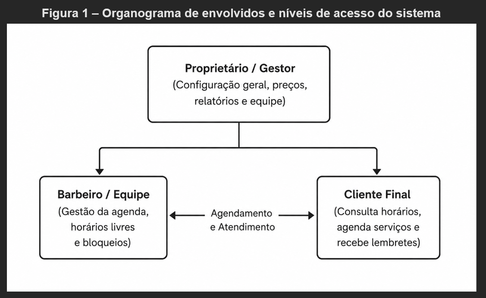

<div align="center">

  

  <h1>BarberFlow</h1>

  <p>
    <strong>Sistema Web de Agendamento e Gestão para Barbearias Locais</strong><br />
    <sub>Squad 01 • Garantia da Qualidade de Software • Centro Universitário UNISOCIESC (2026)</sub>
  </p>

  <p>
    
    
    
    
  </p>

  <br />

  <a href="https://htmlpreview.github.io/?https://github.com/koji02lisome-netizen/BarberFlow/blob/main/prototypes/html/BarberFlow-visao-geral-unico.html">
    
  </a>

  <p>
    <sub>
      🌐 <a href="https://koji02lisome-netizen.github.io/BarberFlow/"><strong>GitHub Pages (Live)</strong></a>
      &nbsp;•&nbsp;
      🎬 <a href="prototypes/mockups/video-demonstracao.mp4"><strong>Vídeo Demonstrativo (MP4)</strong></a>
      &nbsp;•&nbsp;
      💻 <a href="prototypes/html/visao-geral.html"><strong>Código do Board Modular</strong></a>
      &nbsp;•&nbsp;
      📦 <a href="prototypes/html/BarberFlow-visao-geral-unico.html"><strong>Board Autocontido (Single-File)</strong></a>
    </sub>
  </p>

</div>

---

## 📱 Vitrine Visual das Interfaces (Jornada `S1` a `S5`)

> Navegue pelo fluxo completo clicando no botão **Abrir Board Interativo Online** acima (com setas laterais e paginação) ou inspecione cada etapa individualmente na tabela abaixo:

<table>
  <thead>
    <tr>
      <th align="center" width="20%">S1 • Catálogo</th>
      <th align="center" width="20%">S2 • Agenda</th>
      <th align="center" width="20%">S3 • Identificação</th>
      <th align="center" width="20%">S4 • Confirmação</th>
      <th align="center" width="20%">S5 • Painel Barbeiro</th>
    </tr>
  </thead>
  <tbody>
    <tr>
      <td align="center">
        <a href="prototypes/html/tela1.html">
          
        </a>
      </td>
      <td align="center">
        <a href="prototypes/html/tela2.html">
          
        </a>
      </td>
      <td align="center">
        <a href="prototypes/html/tela3.html">
          
        </a>
      </td>
      <td align="center">
        <a href="prototypes/html/tela4.html">
          
        </a>
      </td>
      <td align="center">
        <a href="prototypes/html/tela5.html">
          
        </a>
      </td>
    </tr>
    <tr>
      <td align="center">
        <sub>Seleção de barbeiro, serviços com duração/preço e cálculo de total estimado.</sub>
      </td>
      <td align="center">
        <sub>Seletor de data e grade por turnos (livres, indisponíveis e bloqueados).</sub>
      </td>
      <td align="center">
        <sub>Recibo de conferência, Nome/WhatsApp e reserva temporária de 10 min.</sub>
      </td>
      <td align="center">
        <sub>Protocolo <code>#BF-45G2</code>, endereço, tolerância (10 min) e cancelamento (2h).</sub>
      </td>
      <td align="center">
        <sub>Timeline do dia (Concluído, Em Atendimento, Agendado) e bloqueio de almoço.</sub>
      </td>
    </tr>
    <tr>
      <td align="center">
        <sub>
          <a href="https://htmlpreview.github.io/?https://github.com/koji02lisome-netizen/BarberFlow/blob/main/prototypes/html/tela1.html">▶ Preview</a> •
          <a href="prototypes/html/tela1.html">HTML</a>
        </sub>
      </td>
      <td align="center">
        <sub>
          <a href="https://htmlpreview.github.io/?https://github.com/koji02lisome-netizen/BarberFlow/blob/main/prototypes/html/tela2.html">▶ Preview</a> •
          <a href="prototypes/html/tela2.html">HTML</a>
        </sub>
      </td>
      <td align="center">
        <sub>
          <a href="https://htmlpreview.github.io/?https://github.com/koji02lisome-netizen/BarberFlow/blob/main/prototypes/html/tela3.html">▶ Preview</a> •
          <a href="prototypes/html/tela3.html">HTML</a>
        </sub>
      </td>
      <td align="center">
        <sub>
          <a href="https://htmlpreview.github.io/?https://github.com/koji02lisome-netizen/BarberFlow/blob/main/prototypes/html/tela4.html">▶ Preview</a> •
          <a href="prototypes/html/tela4.html">HTML</a>
        </sub>
      </td>
      <td align="center">
        <sub>
          <a href="https://htmlpreview.github.io/?https://github.com/koji02lisome-netizen/BarberFlow/blob/main/prototypes/html/tela5.html">▶ Preview</a> •
          <a href="prototypes/html/tela5.html">HTML</a>
        </sub>
      </td>
    </tr>
  </tbody>
</table>

---

## 📚 Documentação & Engenharia de Software

<table>
  <thead>
    <tr>
      <th align="left">Domínio</th>
      <th align="left">Artefato Principal</th>
      <th align="left">Escopo Documentado</th>
    </tr>
  </thead>
  <tbody>
    <tr>
      <td><strong>Resumo Executivo</strong></td>
      <td><a href="docs/relatorio-final/resumo-executivo.md"><code>resumo-executivo.md</code></a></td>
      <td>Visão geral do projeto, solução proposta, MVP vs. roadmap futuro e conclusões.</td>
    </tr>
    <tr>
      <td><strong>Modelo de Negócio</strong></td>
      <td><a href="docs/modelo-de-negocio/modelo-de-negocio.md"><code>modelo-de-negocio.md</code></a></td>
      <td>Gargalos do agendamento manual, 4 pilares, síntese Canvas e comparativo (<em>AppBarber</em> / <em>Booksy</em>).</td>
    </tr>
    <tr>
      <td><strong>Requisitos</strong></td>
      <td><a href="docs/requisitos/requisitos.md"><code>requisitos.md</code></a></td>
      <td>Requisitos Funcionais (<code>RF01</code>–<code>RF14</code>) e Não Funcionais (<code>RNF01</code>–<code>RNF10</code>).</td>
    </tr>
    <tr>
      <td><strong>Regras de Negócio</strong></td>
      <td><a href="docs/regras-de-negocio/regras-de-negocio.md"><code>regras-de-negocio.md</code></a></td>
      <td>Trava de concorrência, preços/duração, bloqueio de pausa, prazos de 10 min e cancelamento 2h (<code>RN01</code>–<code>RN10</code>).</td>
    </tr>
    <tr>
      <td><strong>Diagramas & Fluxo</strong></td>
      <td><a href="docs/diagramas/diagramas.md"><code>diagramas.md</code></a> • <a href="docs/diagramas/fluxograma-operacional.png"><code>fluxograma-operacional.png</code></a></td>
      <td>Fluxograma operacional com validação de disponibilidade e ciclo integrado em 5 fases.</td>
    </tr>
    <tr>
      <td><strong>Personas & Storyboards</strong></td>
      <td><a href="docs/personas-e-storyboards/personas-e-storyboards.md"><code>personas-e-storyboards.md</code></a></td>
      <td>Perfis Ricardo (Proprietário), Lucas (Cliente) e Thiago (Barbeiro) — cenários <em>Antes vs. Com o Sistema</em>.</td>
    </tr>
    <tr>
      <td><strong>Planejamento & Equipe</strong></td>
      <td><a href="docs/planejamento/planejamento.md"><code>planejamento.md</code></a> • <a href="docs/planejamento/organograma.png"><code>organograma.png</code></a></td>
      <td>Squad 01, hierarquia de atores/acessos e cronograma completo de entregas (Wayhub e Jornada Acadêmica).</td>
    </tr>
    <tr>
      <td><strong>Metodologia & Git</strong></td>
      <td><a href="docs/metodologia/metodologia.md"><code>metodologia.md</code></a></td>
      <td>Transição Cascata → Scrum/Kanban, 5 níveis de teste e política de branches Git.</td>
    </tr>
    <tr>
      <td><strong>Gestão de Riscos</strong></td>
      <td><a href="docs/gestao-de-riscos/matriz-de-riscos.md"><code>matriz-de-riscos.md</code></a></td>
      <td>Matriz de riscos técnicos e de cronograma (<code>R01</code>–<code>R05</code>) com Plano B de contingência.</td>
    </tr>
    <tr>
      <td><strong>QA & Validação</strong></td>
      <td>
        <a href="tests/matriz-de-testes.md"><code>matriz-de-testes.md</code></a> •
        <a href="tests/casos-de-teste.md"><code>casos-de-teste.md</code></a><br />
        <a href="tests/criterios-de-aceitacao.md"><code>criterios-de-aceitacao.md</code></a> •
        <a href="tests/resultados-da-validacao.md"><code>resultados-da-validacao.md</code></a>
      </td>
      <td>Rastreabilidade RF/RN → Telas, 13 casos de teste (<code>CT01</code>–<code>CT13</code>), critérios BDD e relatório de aprovação.</td>
    </tr>
  </tbody>
</table>

---

## 🗂️ Detalhes Técnicos, Diagramas e Estrutura do Projeto

<details>
  <summary><strong>📊 Visualizar Fluxograma Operacional e Organograma de Atores</strong></summary>
  <br />
  <div align="center">
    <p><strong>Fluxograma Operacional do Processo de Agendamento</strong></p>
    
    <br /><br />
    <p><strong>Organograma de Envolvidos e Níveis de Acesso</strong></p>
    
  </div>
</details>

<details>
  <summary><strong>📁 Visualizar Árvore Completa de Diretórios</strong></summary>
  <br />

```text
BarberFlow/
├── index.html                                           # Redirecionamento automático para o board interativo
├── README.md                                            # Vitrine visual e índice geral do projeto
├── .gitignore                                           # Regras de exclusão (_inbox/ e temporários de SO/IDE)
├── docs/
│   ├── documentos-originais/
│   │   ├── A3 Squad 01 - App Barbearias (2).docx
│   │   ├── Sistema Web para Barbearias - Cockpit.pdf
│   │   ├── pre-projeto-squad1official.pdf
│   │   └── roteiro_gravacao_cockpit_barbearia.pdf
│   ├── modelo-de-negocio/
│   │   └── modelo-de-negocio.md
│   ├── requisitos/
│   │   └── requisitos.md
│   ├── regras-de-negocio/
│   │   └── regras-de-negocio.md
│   ├── diagramas/
│   │   ├── diagramas.md
│   │   └── fluxograma-operacional.png
│   ├── personas-e-storyboards/
│   │   └── personas-e-storyboards.md
│   ├── planejamento/
│   │   ├── organograma.png
│   │   └── planejamento.md
│   ├── metodologia/
│   │   └── metodologia.md
│   ├── gestao-de-riscos/
│   │   └── matriz-de-riscos.md
│   └── relatorio-final/
│       └── resumo-executivo.md
├── prototypes/
│   ├── html/
│   │   ├── visao-geral.html                             # Board interativo modular (iframes S1–S5)
│   │   ├── BarberFlow-visao-geral-unico.html            # Board autocontido (Base64 + srcdoc para preview online)
│   │   ├── tela1.html                                   # S1: Catálogo & Profissional
│   │   ├── tela2.html                                   # S2: Agenda & Horários
│   │   ├── tela3.html                                   # S3: Dados & Confirmação
│   │   ├── tela4.html                                   # S4: Agendamento Confirmado
│   │   └── tela5.html                                   # S5: Painel do Barbeiro
│   ├── imagens/
│   │   ├── logo.png
│   │   ├── prototipoofficialtela1.png
│   │   ├── prototipoofficialtela2.png
│   │   ├── prototipoofficialtela3.png
│   │   ├── PROTOTIPOOFFICIALTELA4.png
│   │   └── prototipoofficialtela5.png
│   └── mockups/
│       ├── primeiro-prototipo-mockup.jpeg
│       └── video-demonstracao.mp4
└── tests/
    ├── matriz-de-testes.md
    ├── casos-de-teste.md
    ├── criterios-de-aceitacao.md
    └── resultados-da-validacao.md
```

</details>

<details>
  <summary><strong>🌿 Fluxo de Branches (GitFlow) e Equipe (Squad 01)</strong></summary>
  <br />

  ### Fluxo de Branches
  - **`main`**: Branch principal estável com entregas consolidadas e prontas para avaliação.
  - **`develop`**: Branch de integração contínua das entregas temáticas.
  - **`feature/*`**: Branches dedicadas por escopo (`feature/documentacao`, `feature/prototipos`, `feature/organizacao-assets`, `feature/requisitos`, `feature/regras-de-negocio`, `feature/documentacao-complementar`, `feature/validacao`, `feature/readme-visual`).

  ### Equipe Responsável — Squad 01 (UNISOCIESC • 2026)
  - **Pablo Guerra Prado** (RA: `122514854`)
  - **Claufer Hudson Ferreira**
  - **Miguel Soares**
  - **Anderson Kauan Júlio**
  - *Professores Orientadores:* Anderson e Diego

</details>
