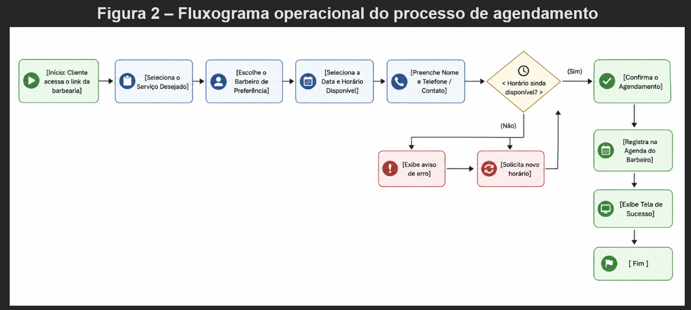

# Diagramas e Fluxo Operacional — BarberFlow

Este documento descreve a arquitetura operacional do processo de agendamento e integra o diagrama visual extraído do Pré-Projeto e do Documento A3.

---

## 1. Fluxograma Operacional do Processo de Agendamento

### Etapas do Fluxo

1. **Início:** O cliente final acessa a aplicação pelo **link direto e exclusivo** da barbearia no navegador.
2. **Seleção do Serviço:** O cliente escolhe um ou mais serviços do catálogo (com preço e duração estimada definidos — tela `S1`).
3. **Escolha do Barbeiro:** O cliente seleciona o barbeiro de sua preferência (tela `S1`).
4. **Seleção de Data e Horário:** O cliente consulta a grade em tempo real (`Manhã`, `Tarde`, `Noite`) e seleciona um slot livre, evitando horários indisponíveis ou bloqueados (tela `S2`).
5. **Preenchimento de Dados:** O cliente informa **Nome Completo**, **WhatsApp (com DDD)** e observações opcionais (tela `S3`, com reserva temporária de 10 minutos).
6. **Ponto de Decisão — Validação de Disponibilidade (`Horário ainda disponível?`):**
   - **Não (Indisponível):** O sistema exibe alerta de erro informando conflito de horário e solicita que o cliente selecione um novo slot.
   - **Sim (Disponível):** O sistema efetua a trava atômica do horário, **confirma o agendamento**, **registra na agenda do barbeiro** (visível em `S5`), exibe a **Tela de Sucesso** com código de protocolo (`S4`) e encerra o fluxo do cliente sem conflitos.

---

## 2. Sequência de Operação Integrada (5 Fases — Visão Completa A3)

| Fase | Etapa | Descrição Operacional |
| :--- | :--- | :--- |
| **Fase 1** | **Consulta** | Cliente acessa o link direto e filtra serviços, profissional e horários livres em tempo real. |
| **Fase 2** | **Reserva e Validação** | Servidor valida concorrência, trava a janela de tempo (eliminando duplo agendamento) e grava na agenda. |
| **Fase 3** | **Execução** | Barbeiro acompanha e inicia o atendimento guiado pelo Painel Diário (`Agendado` → `Em Atendimento`). |
| **Fase 4** | **Conclusão e PDV** *(A3)* | Conclusão do serviço atualiza o histórico técnico na ficha do cliente e lançamentos no PDV decrementam o estoque. |
| **Fase 5** | **Fechamento Gerencial** *(A3)* | Proprietário analisa consolidação financeira, ticket médio e retenção mensal no Dashboard Gerencial. |
