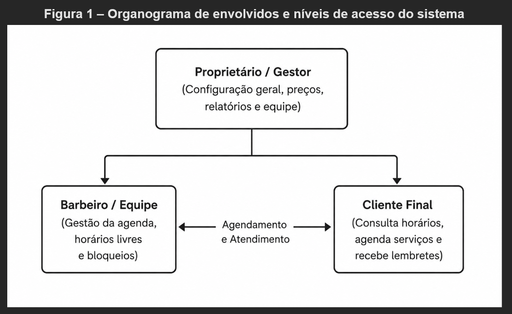

# Planejamento, Equipe e Organograma — BarberFlow

Este documento consolida a estrutura de envolvidos, níveis de acesso e o cronograma de atividades e entregas acadêmicas do projeto **BarberFlow** (Unidade Curricular: Garantia da Qualidade de Software — Centro Universitário UNISOCIESC, 2026).

---

## 1. Equipe do Projeto (Squad 01)

| Integrante | Papel / Participação Documentada |
| :--- | :--- |
| **Pablo Guerra Prado** (RA: `122514854`) | Levantamento de requisitos, personas, storyboards, fluxograma, consolidação documental ABNT e apresentação do bloco de problema/modelo de negócio. |
| **Claufer Hudson Ferreira** | Levantamento de requisitos, personas, storyboards, fluxograma, consolidação documental ABNT e apresentação de proposta de valor/concorrentes. |
| **Miguel Soares** | Prototipação das telas, setup do repositório Git, revisão de pôster acadêmico e apresentação do fluxo de agendamento e painel do barbeiro. |
| **Anderson Kauan Júlio** | Prototipação das telas, setup do repositório Git, revisão de pôster acadêmico e apresentação de telas/estoque/relatórios. |

- **Professores Orientadores:** Anderson e Diego.

---

## 2. Organograma de Envolvidos e Níveis de Acesso

| Ator / Perfil | Nível Hierárquico e Responsabilidades no Sistema |
| :--- | :--- |
| **Proprietário / Gestor** | Topo da hierarquia operacional, com permissão irrestrita: configuração geral do estabelecimento, definição da tabela de preços e serviços, gestão da equipe de barbeiros e acesso exclusivo a relatórios gerenciais e faturamento. |
| **Barbeiro / Equipe** | Subordinado à gestão, com autonomia sobre sua agenda pessoal: definição de horários livres, registro de bloqueios (pausas/almoço), consulta ao histórico técnico de cortes e lançamento de atendimentos/PDV. |
| **Cliente Final** | Ponta de autoatendimento: acesso via link direto para consultar horários disponíveis em tempo real, selecionar serviços/profissional, efetuar reservas e receber comprovante/lembretes. |

---

## 3. Cronograma de Atividades e Marcos (2026)

| Período | Atividade / Entrega | Responsáveis | Marco | Status (ref. A3 18/11) |
| :--- | :--- | :--- | :--- | :--- |
| `12/08 – 04/09` | Definição do modelo de negócio, escopo e análise de concorrentes | Toda a equipe | Pré-Projeto | Concluído |
| `05/09 – 25/09` | Levantamento de requisitos, personas, storyboards e fluxograma | Pablo e Claufer | Documentação | Concluído |
| `26/09 – 21/10` | Prototipação das telas (exceto login), setup Git e entrega Sprint 1 | Miguel e Anderson | Wayhub `21/10` | Concluído |
| `22/10 – 10/11` | Revisão das interfaces, plano de testes e matriz de riscos | Toda a equipe | Qualidade | Concluído |
| `11/11 – 18/11` | Consolidação da documentação ABNT e entrega inicial no Wayhub | Claufer e Pablo | Wayhub `18/11` | Em curso |
| `19/11 – 23/11` | Gravação final do Pitch em vídeo (90s) e ajustes do relatório final | Toda a equipe | Deadline `23/11` | Planejado |
| `24/11 – 29/11` | Elaboração e revisão do pôster acadêmico e ensaio da banca | Miguel e Anderson | Pré-Jornada | Planejado |
| `30/11 – 05/12` | Apresentação oficial na Jornada Acadêmica UNISOCIESC | Toda a equipe | Jornada Acad. | Planejado |
